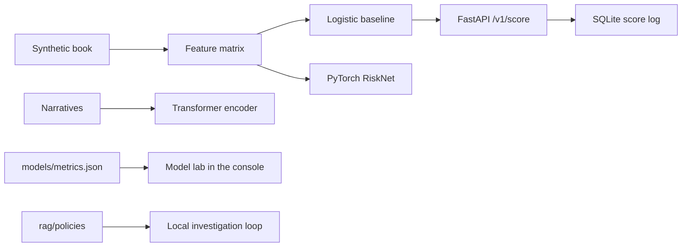

# RiskLens AI — what is actually built

Days 1–21 train, days 22–24 choose the threshold, days 25–30 are the only reported test. The label is a noisy synthetic injection. The served model is the logistic baseline. RiskNet and the narrative transformer are compared and are not automatically promoted.

A score asks an analyst to look. The API field `action` is always `none`.

Docker Compose starts the API and PostgreSQL. The API does not yet read or write PostgreSQL; the score log is SQLite. Kubernetes, KServe, Vertex AI, Feast, MLflow, Prometheus, and Grafana are not implemented in this pass.
