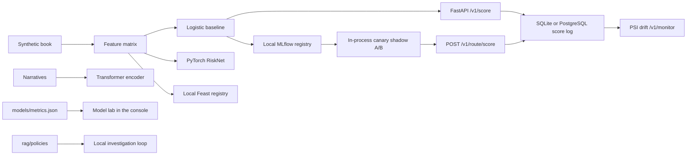

# RiskLens AI — what is actually built

Days 1–21 train, days 22–24 choose the threshold, days 25–30 are the only reported test. The label is a noisy synthetic injection. The served model is the logistic baseline. RiskNet and the narrative transformer are compared and are not automatically promoted.

A score asks an analyst to look. The API field `action` is always `none`.

`POST /v1/score` scores the checked-in baseline. `POST /v1/route/score` scores one of two registered versions. The route file names the versions and the weight. Canary and A/B serve the version the key lands on. Shadow serves the primary, and the candidate score stays off the decision. Scoring leaves the champion alias where it is. The split runs in this process. `GET /v1/monitor` computes one PSI for the served book, counts those rows by model, and adds a PSI for a model only after that model has 30 rows of its own. When one ready model alerts and another does not, the payload names the alerting model. The route file and the champion alias stay where they are.

Docker Compose starts the API and PostgreSQL. The API writes `score_events` to PostgreSQL when `DATABASE_URL` is a postgres URL, and to SQLite otherwise. MLflow and Feast run as local file stores. Kubernetes, KServe, Vertex AI, Prometheus, and Grafana are not implemented. No cloud project was provisioned.
